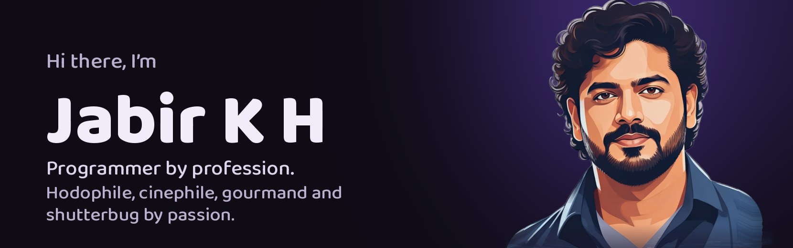
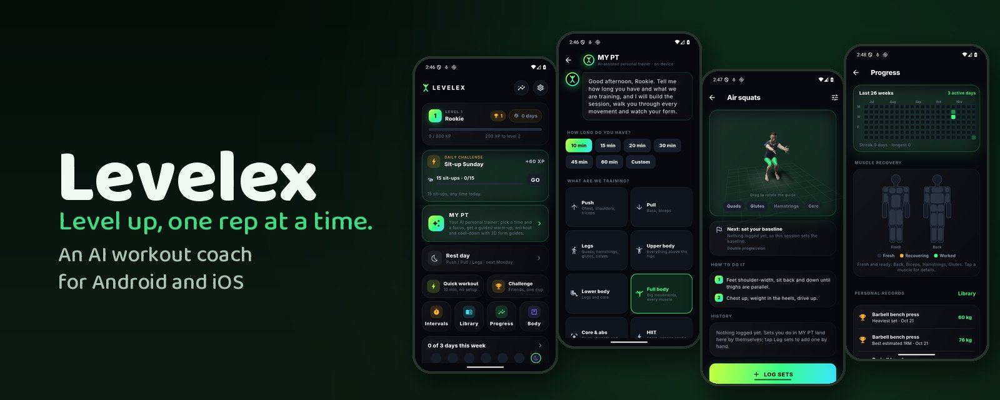
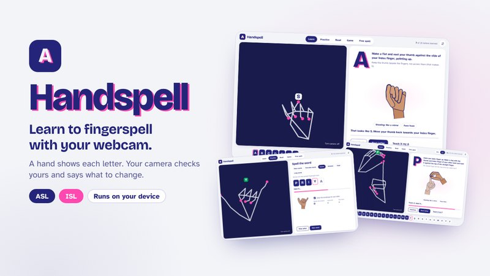
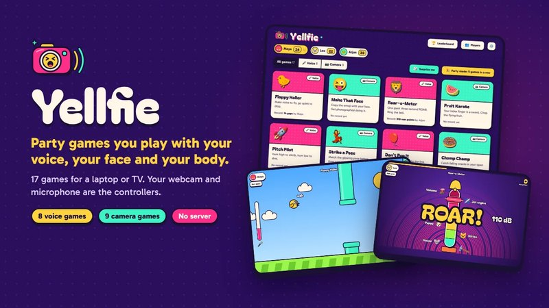
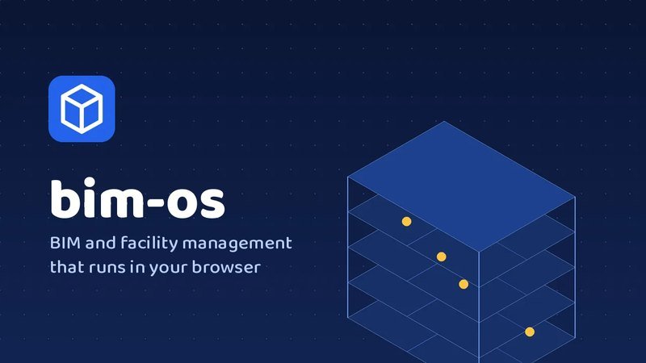
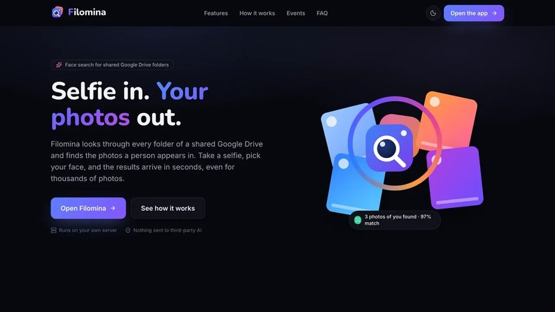
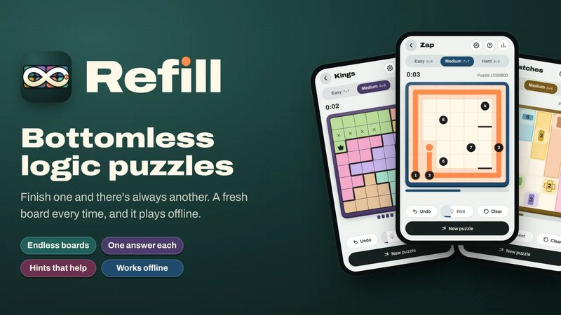
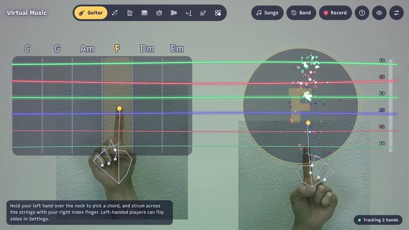

I’m Jabir, a programmer based in Dubai. I build for the web and, lately, for phones, and I like making a device do things you would expect to need a server for: opening building models, finding your face in a folder of photos, counting your reps through the camera, checking your fingerspelling, turning a webcam into a band or a microphone into a game controller. Away from the keyboard I’m usually on the road, watching a film, hunting down something good to eat, or taking photos.

**Portfolio:** [jabir.live](https://jabir.live) 
**Email:** [khjabir@gmail.com](mailto:khjabir@gmail.com)

## What I’m building

<table>
  <tr>
    <td colspan="2" valign="top">
      
      <h3><a href="https://github.com/khjabir/levelex">Levelex</a></h3>
      
An AI workout coach for Android and iOS. Prop your phone up and the camera counts your reps, times your holds and corrects your form while a voice coach talks you through the set. A personal trainer builds sessions around the equipment you own, and every rep earns XP. It all runs on the phone: no account, no cloud, and camera frames never leave the device.

      Flutter, Dart, Google ML Kit, TensorFlow Lite
    </td>
  </tr>
  <tr>
    <td width="50%" valign="top">
      
      <h3><a href="https://github.com/khjabir/handspell">Handspell</a></h3>
      
Learn to fingerspell in American or Indian Sign Language. A hand shows each letter, your webcam checks your handshape as you sign, and it says what to change. The camera picture never leaves your device. <a href="https://handspell.vercel.app"><b>Try it</b></a>

      JavaScript, MediaPipe, Canvas, Web Speech API
    </td>
    <td width="50%" valign="top">
      
      <h3><a href="https://github.com/khjabir/yellfie">Yellfie</a></h3>
      
Party games you play with your voice, your face and your body. Seventeen short games for a group around one laptop or TV, with a leaderboard after every round. No server, no account: the tracking runs in the browser.

      JavaScript, MediaPipe, Web Audio API, Canvas
    </td>
  </tr>
  <tr>
    <td width="50%" valign="top">
      
      <h3><a href="https://github.com/khjabir/bim-os">bim-os</a></h3>
      
BIM and facility management that runs in the browser. Onboard a building from its models, keep its assets and maintenance in order, and open, analyse and convert IFC, Revit and Navisworks files, all on your own machine.

      Next.js, TypeScript, That Open Engine, WebAssembly
    </td>
    <td width="50%" valign="top">
      
      <h3><a href="https://github.com/khjabir/filomina">Filomina</a></h3>
      
Selfie in, your photos out. AI face search for shared Google Drive folders: take a selfie and find every photo you are in, across every nested folder. Faces are matched on your own server with open models.

      Next.js, TypeScript, ONNX Runtime, Docker
    </td>
  </tr>
  <tr>
    <td width="50%" valign="top">
      
      <h3><a href="https://github.com/khjabir/ulg">Refill</a></h3>
      
Bottomless logic puzzles. Six games so far, each board generated on your device with exactly one solution. It installs to your home screen and plays offline. <a href="https://refillgame.vercel.app"><b>Play it</b></a>

      Next.js, React, TypeScript, PWA
    </td>
    <td width="50%" valign="top">
      
      <h3><a href="https://github.com/khjabir/virtual-music">Virtual Music</a></h3>
      
Play instruments in the air. Your webcam tracks your hands: strum a guitar, tap a piano, hit drums, then loop it and play along with a band. No install, no server. <a href="https://virtual-music.vercel.app"><b>Try it</b></a>

      JavaScript, MediaPipe, Web Audio API
    </td>
  </tr>
</table>

## Tools I reach for

## On GitHub since 2014

11,142 contributions across this account and the ones I have used at work. Most of what I wrote between 2015 and 2019 lived in private Bitbucket repositories, so those years look quiet here. [Every year, day by day](https://jabir.live/projects#github), is on my portfolio.

Before the projects above came [create-next-typescript-app](https://github.com/khjabir/create-next-typescript-app) (a TypeScript starter for Next.js, from before `create-next-app` had one), [ui-antd-wrapper](https://github.com/khjabir/ui-antd-wrapper) and [leaflet-wrapper](https://github.com/khjabir/leaflet-wrapper) (component libraries published to npm), a [face recognition](https://github.com/khjabir/face_recognition) project in Python, and the Angular, Node.js and React Native apps I learned on. [All of them](https://jabir.live/projects) are on my portfolio too.
